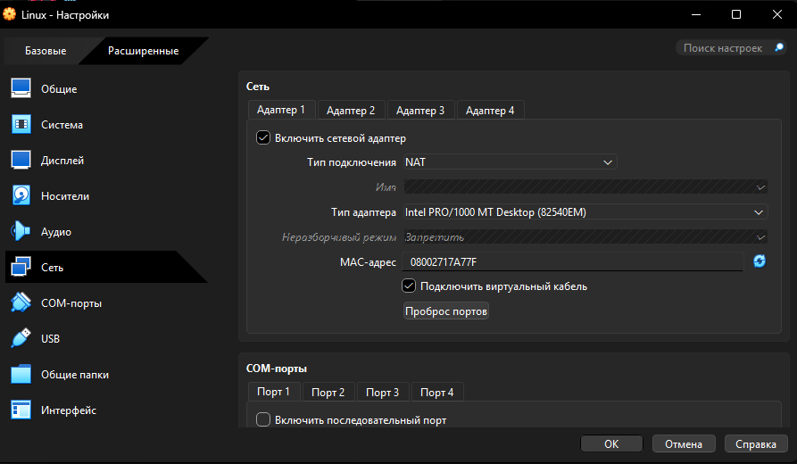
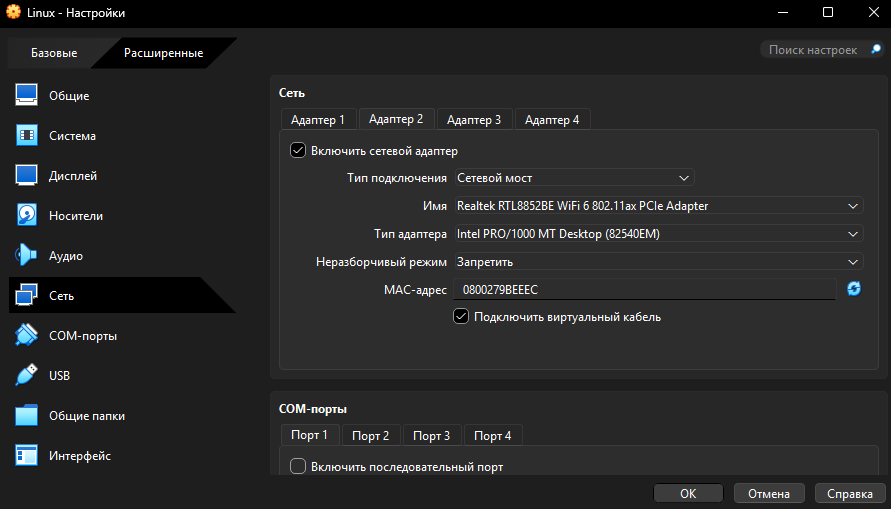
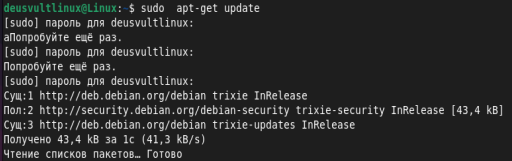
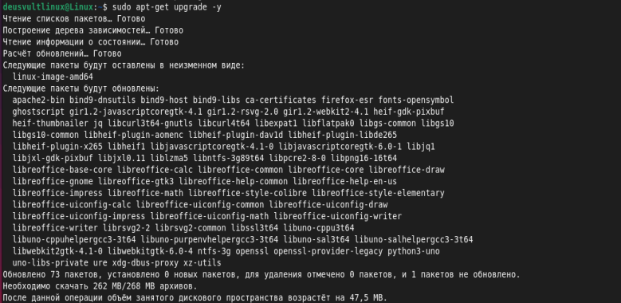
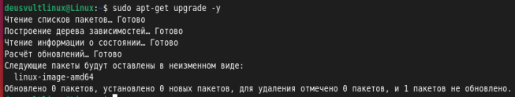
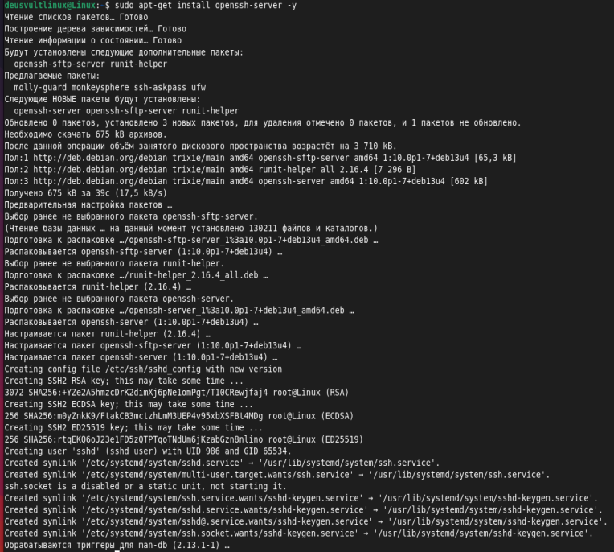
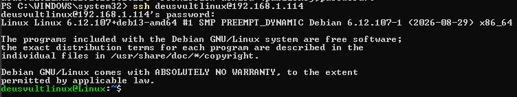
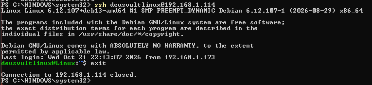

# Лабораторная работа: Введение в виртуальные машины и установка Debian

**Выполнил:** Лугуев Артём Марселевич (группа ИС-25)
**Гостевая ОС:** Debian GNU/Linux 13 (Trixie) x86_64
**Гипервизор:** Oracle VM VirtualBox

---

## Блок 1: Введение в виртуальные машины и установка Debian

### 1. Установка и создание виртуальной машины

1. Установлен и настроен гипервизор Oracle VM VirtualBox.
2. Создана новая виртуальная машина с именем `Linux`, тип ОС — Linux, версия — Debian (64-bit). Подключён ISO-образ Debian 13 Trixie, скачанный с официального сайта [debian.org](https://www.debian.org/distrib/).
3. Для виртуальной машины выделено **4 ГБ** оперативной памяти, **2** вычислительных ядра ЦПУ и создан виртуальный жёсткий диск объёмом **20 ГБ**.

### 2. Установка Debian и настройка основных параметров

1. Выполнена установка Debian 13 (Trixie) на виртуальный диск.
2. В процессе установки заданы основные параметры: имя компьютера (`Linux`), язык (`русский`), часовой пояс (`UTC+7`), учётная запись пользователя `deusvultlinux` и пароли.

### 3. Настройка сети (NAT и Bridged) и обновление системы

#### 3.1. Настройка подключения через NAT и Bridged

Для одновременной работы виртуальной машины с интернетом и локальной сетью хост-компьютера в настройках ВМ (**Настройки → Сеть**) задействованы два сетевых адаптера:

- **Адаптер 1 — NAT** (Intel PRO/1000 MT Desktop): используется для выхода виртуальной машины в интернет через хост.
- **Адаптер 2 — Сетевой мост / Bridged** (Intel PRO/1000 MT Desktop, физический интерфейс хоста — Realtek RTL8852BE WiFi 6 802.11ax PCIe Adapter): ВМ получает адрес в локальной сети хоста (`192.168.1.114`) и становится доступна для подключения с основного компьютера, в том числе по SSH.



*Рис. 1.1 — Настройки адаптера 1 (NAT)*



*Рис. 1.2 — Настройки адаптера 2 (сетевой мост / Bridged)*

#### 3.2. Обновление системы

Выполнена синхронизация индексов репозиториев:

```bash
sudo apt-get update
```

Репозитории `deb.debian.org` (trixie, trixie-updates) и `security.debian.org` (trixie-security) доступны, списки пакетов получены — выход в интернет работает.



*Рис. 2.1 — Выполнение команды `sudo apt-get update`*

Выполнено обновление установленных пакетов:

```bash
sudo apt-get upgrade -y
```

Обновлено 73 пакета (скачано 262 МБ архивов; после установки занятое место на диске увеличилось на 47,5 МБ). Среди обновлённых — `firefox-esr`, пакеты `libreoffice`, `apache2-bin`, `openssl` и др.



*Рис. 2.2 — Выполнение команды `sudo apt-get upgrade -y`*

Для проверки команда запущена повторно: результат «Обновлено 0 пакетов» подтверждает, что система полностью актуальна.



*Рис. 2.3 — Повторный запуск `sudo apt-get upgrade -y`: все пакеты обновлены*

### 4. Настройка SSH-сервера и удалённого доступа

#### 4.1. Установка и запуск SSH-сервера

На виртуальной машине установлен пакет `openssh-server`:

```bash
sudo apt-get install openssh-server -y
```

Установлены пакеты `openssh-server`, `openssh-sftp-server` и `runit-helper` (OpenSSH `1:10.0p1-7+deb13u4`). В процессе установки автоматически сгенерированы серверные ключи (RSA, ECDSA, ED25519) и создан системный пользователь `sshd`.



*Рис. 3.1 — Установка `openssh-server` из репозитория Debian Trixie*

Служба SSH включена в автозагрузку и запущена, её состояние можно проверить командами:

```bash
sudo systemctl enable --now ssh
sudo systemctl status ssh
```

IP-адрес виртуальной машины в локальной сети (интерфейс, подключённый в режиме Bridged) определяется командой `ip a` — в данной работе это `192.168.1.114`.

#### 4.2. Доступ по SSH с основного компьютера по паролю

С хост-машины под управлением Windows (Windows PowerShell) выполнено подключение к виртуальной машине по IP-адресу сетевого моста:

```powershell
ssh deusvultlinux@192.168.1.114
```

При первом подключении подтверждён отпечаток ключа сервера и введён пароль пользователя `deusvultlinux`.



*Рис. 3.2 — Успешная авторизация по SSH с хост-машины по паролю*

#### 4.3. Доступ по SSH по криптографическому ключу

1. На основном компьютере (Windows PowerShell) сгенерирована пара RSA-ключей:

   ```powershell
   ssh-keygen -t rsa -b 4096
   ```

   Ключи сохранены в каталоге `C:\Users\<пользователь>\.ssh\` (`id_rsa` — закрытый, `id_rsa.pub` — открытый).

2. Открытый ключ `id_rsa.pub` необходимо поместить в файл `~/.ssh/authorized_keys` пользователя `deusvultlinux` на виртуальной машине. На ВМ заданы корректные права доступа:

   ```bash
   chmod 700 ~/.ssh
   chmod 600 ~/.ssh/authorized_keys
   ```

3. Выполнено повторное подключение к ВМ:

   ```powershell
   ssh deusvultlinux@192.168.1.114
   ```

   Пароль не запрашивается — вход выполнен автоматически по ключу.



*Рис. 3.3 — Успешный вход по SSH без запроса пароля (аутентификация по ключу)*

**Возникшая проблема и её решение.** При передаче ключа с хоста на виртуальную машину ключ передавался некорректно, и вместо входа по ключу автоматически использовался вход по паролю. Проблема была решена настройкой общего буфера обмена между хостом и виртуальной машиной (**Устройства → Общий буфер обмена → Двунаправленный**): открытый ключ был скопирован на хосте и вручную перенесён в папку `~/.ssh` на ВМ, в файл `authorized_keys`, где он должен находиться. После этого вход по ключу заработал.

---

## Вывод

В рамках лабораторной работы развёрнута виртуальная машина в среде VirtualBox (2 ядра ЦПУ, 4 ГБ ОЗУ, 20 ГБ диска) и установлена ОС Debian 13 (Trixie). Настроена работа двух сетевых адаптеров в режимах NAT и Bridged (`192.168.1.114`), проведено обновление системы с помощью `apt-get update` и `apt-get upgrade`, установлен и запущен SSH-сервер `openssh-server`, а также настроен удалённый доступ с хост-машины по протоколу SSH как по паролю, так и по ключевой паре RSA.
