# Лабораторная работа: Управление пользователями и группами в Linux

**Выполнил:** Лугуев Артём Марселевич (группа ИС-25)
**Операционная система:** Debian GNU/Linux 13 (Trixie) x86_64
**Гипервизор:** Oracle VM VirtualBox
**Пользователь, под которым выполнялась работа:** `deusvultlinux` (права `sudo`)

---

## 1. Создание пользователей и групп

### 1.1. Создание пользователей

Созданы три новых пользователя: `admin`, `user1`, `user2`. Ключ `-m` автоматически создаёт для каждого из них домашний каталог в `/home`.

```bash
sudo useradd -m admin
sudo useradd -m user1
sudo useradd -m user2
```

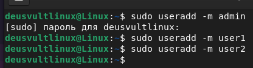

*Рис. 1.1 — Создание пользователей `admin`, `user1`, `user2`*

### 1.2. Создание групп

Созданы две группы: `developers` и `testers`.

```bash
sudo groupadd developers
sudo groupadd testers
```

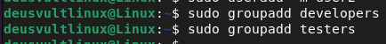

*Рис. 1.2 — Создание групп `developers` и `testers`*

### 1.3. Добавление пользователей в группы

Пользователи `admin` и `user1` добавлены в группу `developers`, пользователь `user2` — в группу `testers`. Ключ `-aG` (append + Group) добавляет пользователя в дополнительную группу, не удаляя его из остальных.

```bash
sudo usermod -aG developers admin
sudo usermod -aG developers user1
sudo usermod -aG testers user2
```

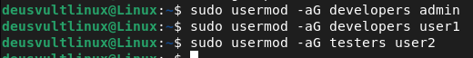

*Рис. 1.3 — Добавление пользователей в группы*

Проверить членство в группах можно командой `groups <имя>` или `id <имя>`.

---

## 2. Настройка прав доступа

### 2.1. Создание каталогов

Созданы каталоги `/home/admin/data` и `/home/admin/logs`. Ключ `-p` создаёт каталог, не выдавая ошибки, если он уже существует (и создаёт недостающие родительские каталоги).

```bash
sudo mkdir -p /home/admin/data
sudo mkdir -p /home/admin/logs
```

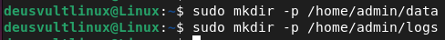

*Рис. 2.1 — Создание каталогов `data` и `logs`*

### 2.2. Настройка владельцев и прав

Требования задания:

- в `data` редактировать файлы может **только** пользователь `admin`;
- в `logs` читать и писать может группа `developers`.

```bash
# data: владелец admin, права только у владельца
sudo chown admin:admin /home/admin/data
sudo chmod 700 /home/admin/data

# logs: владелец admin, группа developers, полный доступ у владельца и группы
sudo chown admin:developers /home/admin/logs
sudo chmod 770 /home/admin/logs
```

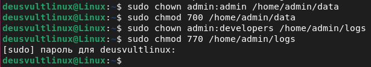

*Рис. 2.2 — Настройка владельцев и прав доступа к каталогам*

---

## 3. Изучение команд для работы с пользователями

| Команда | Назначение | Пример |
|---|---|---|
| `useradd` | Создаёт нового пользователя | `sudo useradd -m admin` |
| `usermod` | Изменяет существующего пользователя (группы, блокировка, домашний каталог, оболочка) | `sudo usermod -aG developers user1` |
| `groupadd` | Создаёт новую группу | `sudo groupadd testers` |
| `passwd` | Устанавливает или меняет пароль пользователя | `sudo passwd user1` |
| `chown` | Меняет владельца и/или группу файла или каталога | `sudo chown admin:developers /home/admin/logs` |
| `chmod` | Меняет права доступа к файлу или каталогу | `sudo chmod 770 /home/admin/logs` |

### 3.1. Смена пароля пользователя user1

```bash
sudo passwd user1
```

Система дважды запрашивает новый пароль; при успехе выводится сообщение «пароль успешно обновлён».

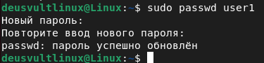

*Рис. 3.1 — Смена пароля пользователя `user1`*

### 3.2. Блокировка учётной записи user2

```bash
sudo usermod -L user2
```

Ключ `-L` (Lock) блокирует пароль пользователя: вход по паролю для `user2` становится невозможен. Разблокировать учётную запись можно командой `sudo usermod -U user2`. Состояние учётной записи проверено командой `sudo passwd -S user2`: статус `L` (Locked) означает, что учётная запись заблокирована.

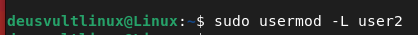

*Рис. 3.2 — Блокировка учётной записи `user2`*

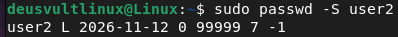

*Рис. 3.3 — Проверка статуса учётной записи `user2` (`L` — заблокирована)*

---

## 4. Мониторинг активности пользователей

### 4.1. Команда `who`

Показывает, **кто сейчас вошёл в систему**: имя пользователя, терминал, дату и время входа (для удалённых подключений — ещё и IP-адрес).

```bash
who
```

В выводе виден пользователь `deusvultlinux`, вошедший в систему в 16:45 (графический сеанс `seat0` и терминал `tty2`).

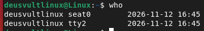

*Рис. 4.1 — Результат команды `who`*

### 4.2. Команда `w`

Показывает то же, что и `who`, но подробнее: текущее время, **время работы системы** (uptime), количество пользователей, **среднюю загрузку** (load average за 1, 5 и 15 минут), а также для каждого пользователя — время простоя (IDLE), потреблённое процессорное время (JCPU, PCPU) и **выполняемую команду** (WHAT).

```bash
w
```

В выводе: система работает 55 минут, вошёл 1 пользователь, средняя загрузка — 0,17 / 0,15 / 0,08, пользователь работает в сеансе `/usr/libexec/gnome-session`.

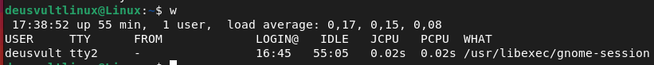

*Рис. 4.2 — Результат команды `w`*

### 4.3. Команда `last`

Показывает **историю входов и выходов** пользователей, а также перезагрузок системы. Данные берутся из файла `/var/log/wtmp`. Полезна для аудита безопасности: видно, кто, когда и откуда (с какого IP-адреса) входил в систему.

```bash
last
```

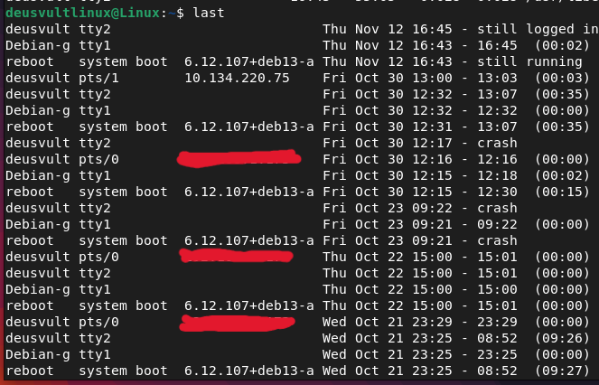

*Рис. 4.3 — Результат команды `last` (последние события)*

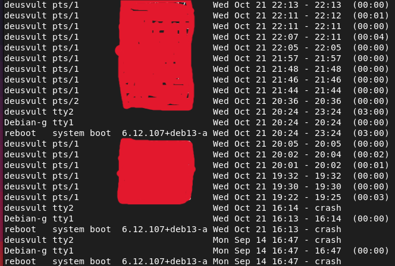

*Рис. 4.4 — Результат команды `last` (продолжение)*

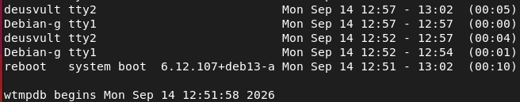

*Рис. 4.5 — Результат команды `last` (начало журнала `wtmp`)*

---

## 5. Автоматизация управления пользователями

Создан bash-скрипт, который читает текстовый файл с заранее заданными именами и автоматически создаёт пользователей и группы.

### 5.1. Файл со списком пользователей

Файл `users_list.txt` (формат: `имя_пользователя:группа`, одна запись на строку):

```
alice:developers
bob:developers
charlie:testers
```

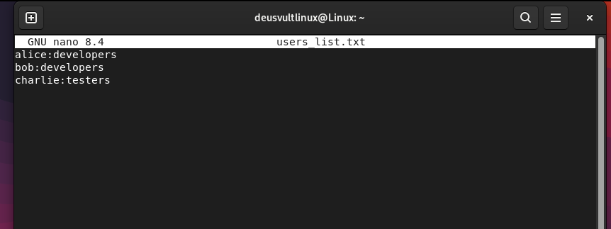

*Рис. 5.1 — Файл `users_list.txt` в редакторе nano*

### 5.2. Скрипт create_users.sh

```bash
#!/bin/bash

# Проверка, запущен ли скрипт от имени root
if [ "$EUID" -ne 0 ]; then
    echo "Пожалуйста, запустите скрипт с правами суперпользователя (sudo)."
    exit 1
fi

# Путь к файлу со списком
CONFIG_FILE="users_list.txt"

if [ ! -f "$CONFIG_FILE" ]; then
    echo "Файл конфигурации $CONFIG_FILE не найден!"
    exit 1
fi

# Читаем файл построчно
while IFS=':' read -r username groupname; do
    # Пропускаем пустые строки
    [ -z "$username" ] && continue

    # Проверяем, существует ли группа, если нет — создаём
    if ! getent group "$groupname" > /dev/null; then
        groupadd "$groupname"
        echo "Создана группа: $groupname"
    fi

    # Проверяем, существует ли пользователь
    if id "$username" &>/dev/null; then
        echo "Пользователь $username уже существует."
    else
        # Создаём пользователя с домашним каталогом и добавляем в группу
        useradd -m -g "$groupname" "$username"
        echo "Создан пользователь: $username и добавлен в группу $groupname"
    fi
done < "$CONFIG_FILE"

echo "Настройка пользователей завершена!"
```

**Как работает скрипт:**

1. Проверяет, что он запущен с правами root (переменная `$EUID` равна 0), иначе завершается с сообщением.
2. Проверяет, что файл `users_list.txt` существует.
3. Читает файл построчно, разделяя строку по символу `:` на имя пользователя и имя группы (`IFS=':'`).
4. Если группы нет (`getent group`), создаёт её командой `groupadd`.
5. Если пользователя нет (`id`), создаёт его командой `useradd -m -g` — с домашним каталогом и основной группой из файла; если есть — сообщает об этом и пропускает.

### 5.3. Запуск скрипта

```bash
nano users_list.txt
nano create_users.sh
chmod +x create_users.sh
sudo ./create_users.sh
```

Скрипт делается исполняемым (`chmod +x`) и запускается с `sudo`. В результате созданы пользователи `alice` и `bob` (группа `developers`) и `charlie` (группа `testers`). Группы `developers` и `testers` уже существовали (созданы в п. 1.2), поэтому повторно скрипт их не создавал.

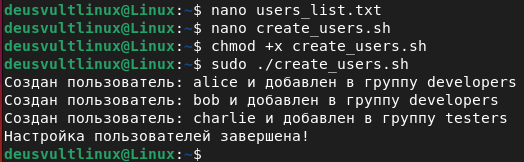

*Рис. 5.2 — Запуск скрипта `create_users.sh`*

---

## Вывод

В ходе лабораторной работы были созданы пользователи `admin`, `user1`, `user2` и группы `developers` и `testers`, пользователи распределены по группам. Настроены права доступа к каталогам `/home/admin/data` (доступ только у `admin`, права `700`) и `/home/admin/logs` (чтение и запись для группы `developers`, права `770`). Изучены команды `useradd`, `usermod`, `groupadd`, `passwd`, `chown`, `chmod`: изменён пароль пользователя `user1` и заблокирована учётная запись `user2`. Для мониторинга активности пользователей использованы команды `who`, `w` и `last`. Написан bash-скрипт, автоматически создающий пользователей и группы из текстового файла.
