# Лабораторная работа: Управление пакетами, сервисами и настройка сети в Debian

**Выполнил:** Лугуев Артём Марселевич (группа ИС-25)
**Операционная система:** Debian GNU/Linux 13 (Trixie) x86_64
**Гипервизор:** Oracle VM VirtualBox
**Пользователь, под которым выполнялась работа:** `deusvultlinux` (права `sudo`)

---

## 1. Управление пакетами

### 1.1. Настройка `/etc/apt/sources.list`

Перед просмотром файла сделана его резервная копия:

```bash
sudo cp /etc/apt/sources.list /etc/apt/sources.list.bak
sudo nano /etc/apt/sources.list
```

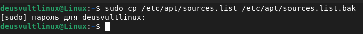

*Рис. 1.1 — Создание резервной копии файла `sources.list`*

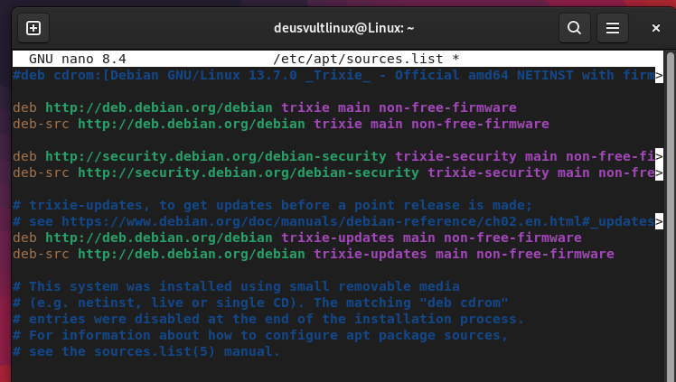

*Рис. 1.2 — Содержимое файла `/etc/apt/sources.list`*

Строка репозитория имеет вид `deb http://deb.debian.org/debian trixie main non-free-firmware`, где:

- `deb` — репозиторий с готовыми (бинарными) пакетами; `deb-src` — с исходным кодом;
- `http://deb.debian.org/debian` — адрес официального сервера-зеркала Debian;
- `trixie` — кодовое имя релиза (Debian 13); `trixie-security` и `trixie-updates` — ветки обновлений безопасности и регулярных обновлений;
- `main`, `non-free-firmware` — компоненты репозитория: основные свободные пакеты и проприетарные микропрограммы (прошивки).

Так как изначальная настройка файла уже позволяла использовать все необходимые репозитории Debian (основной репозиторий, обновления безопасности и `trixie-updates`), а все нужные для работы пакеты находятся в компоненте `main`, файл был **оставлен без изменений**.

Для проверки работоспособности репозиториев обновлён список пакетов:

```bash
sudo apt update
```

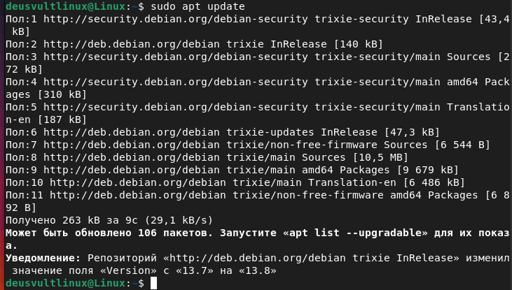

*Рис. 1.3 — Выполнение команды `sudo apt update`*

Репозитории доступны, списки пакетов успешно получены (263 кБ), доступно обновление 106 пакетов.

### 1.2. Установка пакетов

Установлены пакеты `vim`, `curl`, `net-tools`, `apache2`:

```bash
sudo apt install -y vim curl net-tools apache2
```

Вместе с ними автоматически установлены зависимости (`apache2-data`, `apache2-utils`, `vim-runtime`); объём загрузки составил 12,6 МБ.

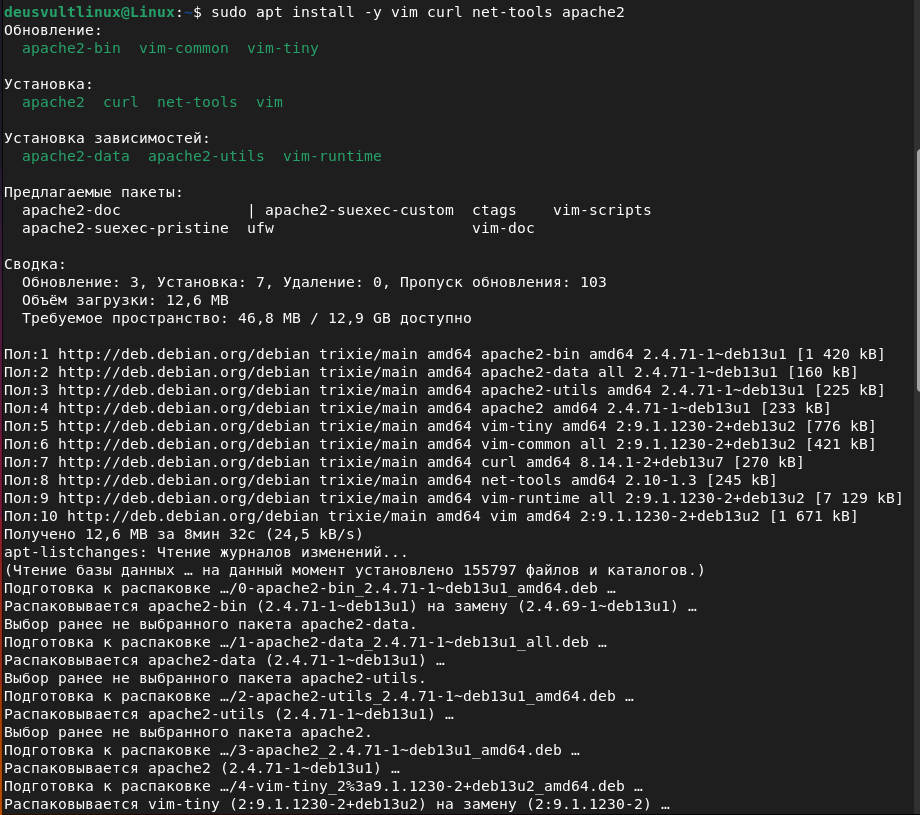

*Рис. 1.4 — Установка пакетов: расчёт зависимостей и загрузка*

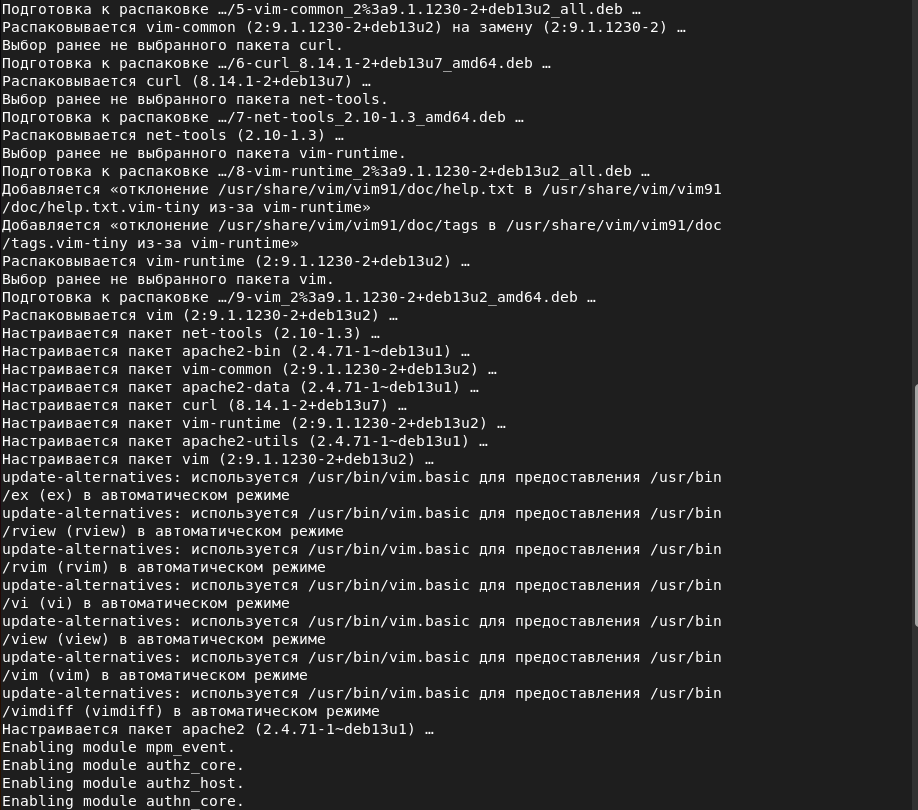

*Рис. 1.5 — Установка пакетов: распаковка и настройка*

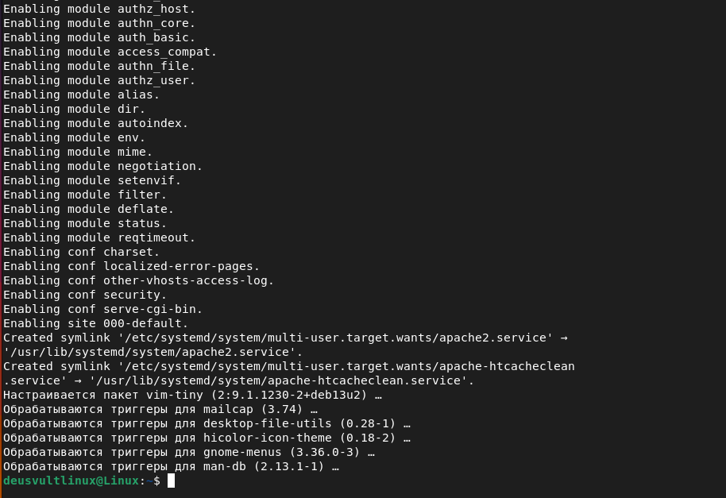

*Рис. 1.6 — Установка пакетов: завершение, включение службы `apache2`*

Проверка установки — вывод версий программ:

```bash
curl --version
vim --version
sudo apache2 -v
ifconfig
```

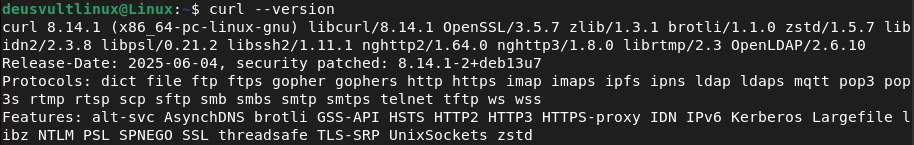

*Рис. 1.7 — Версия `curl` (8.14.1)*

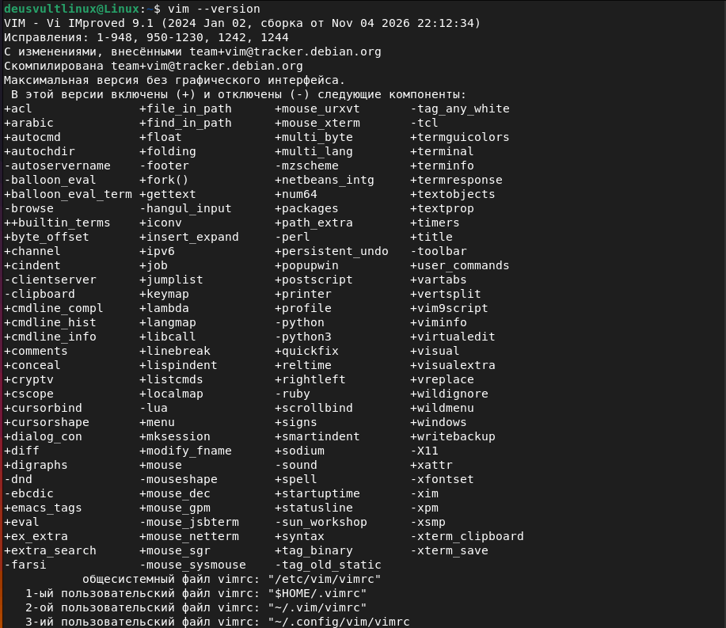

*Рис. 1.8 — Версия `vim` (9.1)*

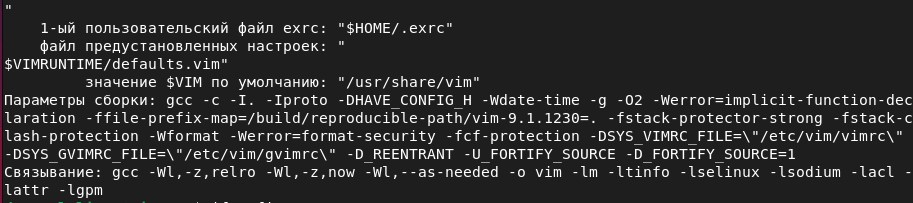

*Рис. 1.9 — Версия `vim` (продолжение вывода)*

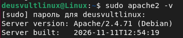

*Рис. 1.10 — Версия `apache2` (2.4.71)*

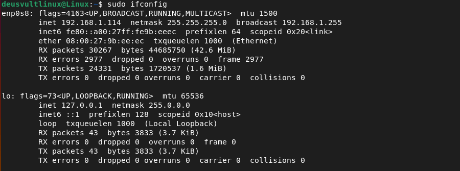

*Рис. 1.11 — Вывод `ifconfig` (утилита из пакета `net-tools`)*

### 1.3. Bash-скрипт для установки пакетов

Создан скрипт `install_packages.sh`:

```bash
#!/bin/bash
set -e

if [ "$EUID" -ne 0 ]; then
  echo "Запустите скрипт через sudo: sudo ./install_packages.sh"
  exit 1
fi

apt update
apt install -y vim curl net-tools apache2
echo "Все пакеты успешно установлены."
```

Принцип работы: `set -e` прерывает выполнение скрипта при первой ошибке; проверка `$EUID` гарантирует запуск с правами root; затем обновляется список пакетов и устанавливаются все необходимые пакеты.

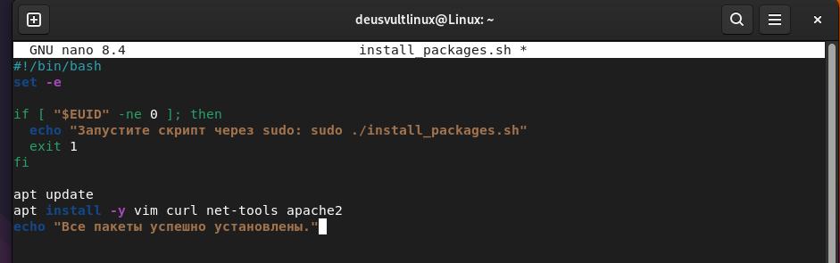

*Рис. 1.12 — Скрипт `install_packages.sh` в редакторе nano*

Скрипт сделан исполняемым и запущен:

```bash
chmod +x install_packages.sh
sudo ./install_packages.sh
```

Так как все пакеты уже были установлены вручную, скрипт сообщил, что у них самая новая версия, и завершился успешно.

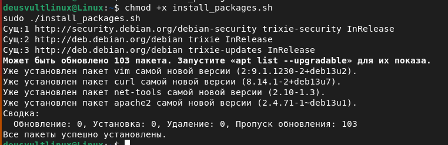

*Рис. 1.13 — Запуск скрипта `install_packages.sh`*

---

## 2. Работа с системными сервисами

### 2.1. Управление сервисами через systemctl

Настроен автозапуск Apache (`apache2`) и SSH (`ssh`) при старте системы, службы запущены, проверен их статус:

```bash
sudo systemctl enable apache2 ssh     # включить автозапуск
sudo systemctl start apache2 ssh      # запустить службы
sudo systemctl status apache2         # проверить статус
sudo systemctl status ssh
```

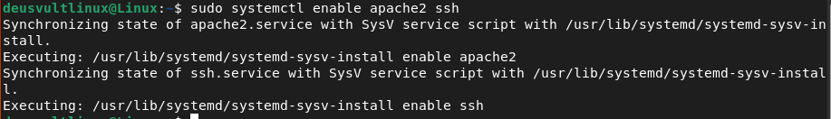

*Рис. 2.1 — Включение автозапуска служб `apache2` и `ssh`*

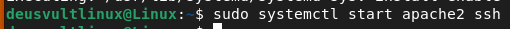

*Рис. 2.2 — Запуск служб `apache2` и `ssh`*

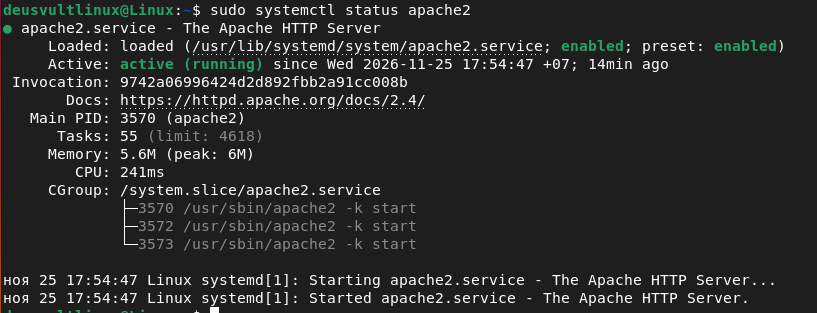

*Рис. 2.3 — Статус службы `apache2`: `active (running)`, `enabled`*

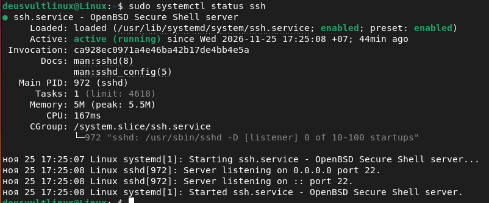

*Рис. 2.4 — Статус службы `ssh`: `active (running)`, `enabled`, прослушивается порт 22*

Для демонстрации работы команд отключения и включения автозапуска служба Apache была отключена, а затем включена обратно:

```bash
sudo systemctl disable apache2
sudo systemctl enable apache2
```

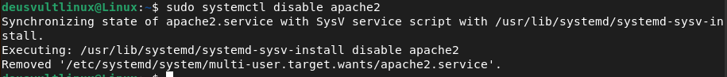

*Рис. 2.5 — Отключение автозапуска `apache2`*

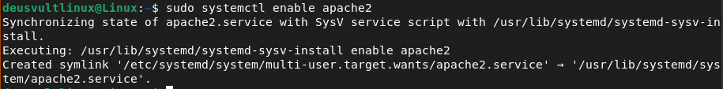

*Рис. 2.6 — Повторное включение автозапуска `apache2`*

### 2.2. Ежедневный перезапуск Apache через cron

Задание добавлено в crontab пользователя root (чтобы команда выполнялась с нужными правами без запроса пароля):

```bash
sudo crontab -e
```

В конец файла добавлена строка:

```
0 3 * * * /usr/sbin/service apache2 restart
```

Формат записи: `минута час день_месяца месяц день_недели команда`. Запись `0 3 * * *` означает «в 03:00 каждый день»; в команде указан полный путь к исполняемому файлу.

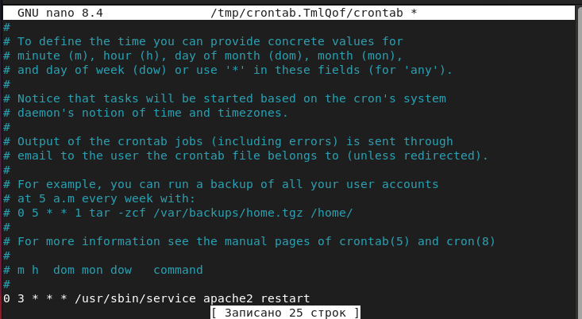

*Рис. 2.7 — Добавление задания в crontab*

Проверка списка заданий:

```bash
sudo crontab -l
```

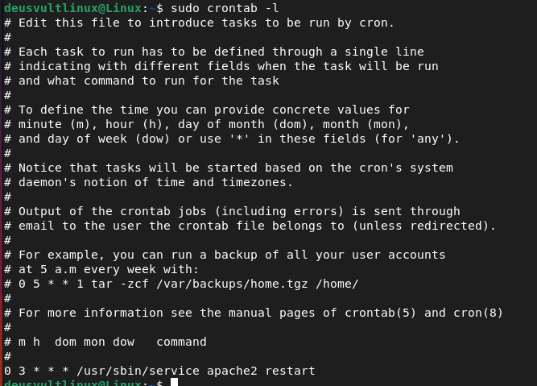

*Рис. 2.8 — Задание на ежедневный перезапуск Apache добавлено*

---

## 3. Конфигурация сети

### 3.1. Определение текущих сетевых параметров

Перед настройкой статического адреса определены текущие параметры сети:

```bash
ip -br addr
ip route show default
cat /etc/resolv.conf
```

Виртуальная машина использует интерфейс `enp0s8` (режим сетевого моста), адрес `192.168.1.114/24` получен по DHCP, шлюз по умолчанию — `192.168.1.1`, DNS-сервер — `192.168.1.1`.

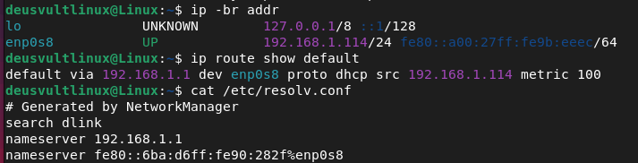

*Рис. 3.1 — Текущий IP-адрес, шлюз и DNS-сервер*

### 3.2. Изучение файла `/etc/network/interfaces`

```bash
cat /etc/network/interfaces
```

В файле описан только интерфейс обратной петли (`lo`), а также подключается каталог `/etc/network/interfaces.d/*`. Интерфейс `enp0s8` в файле не описан: им управляет **NetworkManager** (на это указывает комментарий «Generated by NetworkManager» в `/etc/resolv.conf`). Поэтому файл `/etc/network/interfaces` не изменялся, а статический адрес был задан средствами NetworkManager.

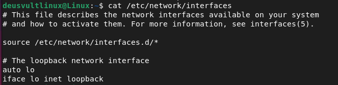

*Рис. 3.2 — Содержимое файла `/etc/network/interfaces`*

### 3.3. Настройка статического IP-адреса

Определено имя сетевого подключения NetworkManager:

```bash
nmcli connection show
```

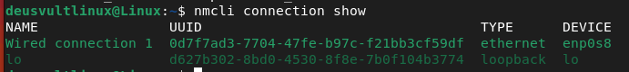

*Рис. 3.3 — Подключение `Wired connection 1` для устройства `enp0s8`*

Для подключения заданы статический адрес, шлюз и DNS-серверы, способ получения адреса — `manual`:

```bash
sudo nmcli connection modify "Wired connection 1" \
  ipv4.addresses 192.168.1.150/24 \
  ipv4.gateway 192.168.1.1 \
  ipv4.dns "192.168.1.1 1.1.1.1" \
  ipv4.method manual
```

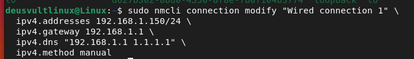

*Рис. 3.4 — Настройка статического IP-адреса через `nmcli`*

Проверка заданных параметров:

```bash
sudo nmcli connection show "Wired connection 1" | grep -E "ipv4\.(addresses|gateway|dns|method)"
```

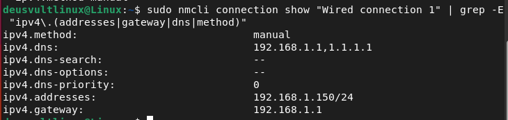

*Рис. 3.5 — Параметры подключения: метод `manual`, адрес `192.168.1.150/24`, шлюз `192.168.1.1`, DNS `192.168.1.1, 1.1.1.1`*

Подключение перезапущено для применения настроек:

```bash
sudo nmcli connection up "Wired connection 1"
```

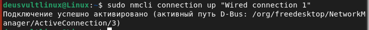

*Рис. 3.6 — Подключение успешно активировано*

> После смены адреса подключаться к виртуальной машине по SSH с основного компьютера необходимо по новому адресу `192.168.1.150`.

### 3.4. Проверка сетевой конфигурации (`ip`, `ifconfig`, `ping`)

```bash
ip -br addr
ip route show default
ping -c 4 192.168.1.1
ping -c 4 8.8.8.8
sudo ifconfig
```

Интерфейс `enp0s8` получил адрес `192.168.1.150/24`, шлюз по умолчанию — `192.168.1.1` (источник маршрута теперь `static`, а не `dhcp`). Оба `ping` — до шлюза и до внешнего узла `8.8.8.8` — прошли без потерь пакетов (0% packet loss).

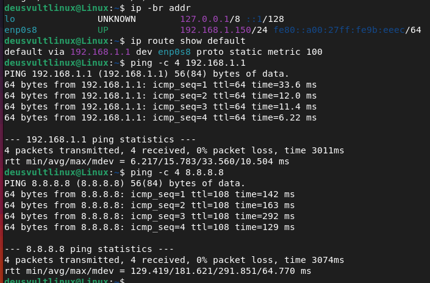

*Рис. 3.7 — Результаты команд `ip` и `ping`*

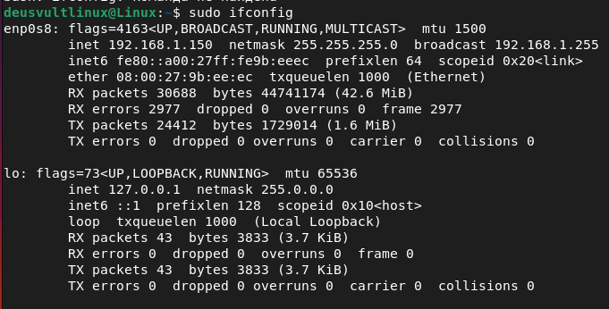

*Рис. 3.8 — Вывод `ifconfig`: у интерфейса `enp0s8` адрес `192.168.1.150`*

| Команда | Назначение |
|---|---|
| `ip addr` / `ip -br addr` | Показывает IP-адреса и состояние сетевых интерфейсов (современная замена `ifconfig`) |
| `ip route` | Показывает таблицу маршрутизации и шлюз по умолчанию |
| `ifconfig` | Классическая утилита (пакет `net-tools`) для просмотра и настройки интерфейсов |
| `ping` | Проверяет доступность узла: отправляет ICMP-пакеты и показывает задержку и процент потерь (`-c 4` — отправить 4 пакета) |

---

## 4. Диагностика сетевых проблем

| Команда | Назначение | Примеры |
|---|---|---|
| `traceroute` | Показывает маршрут пакетов до целевого узла и задержку на каждом промежуточном маршрутизаторе; помогает найти участок сети, где теряются пакеты или растёт задержка | `traceroute 8.8.8.8` |
| `netstat` | Классическая утилита (пакет `net-tools`) для просмотра сетевых соединений, открытых портов и таблицы маршрутизации | `sudo netstat -tulnp`, `netstat -rn` |
| `ss` | Современная и более быстрая замена `netstat` для просмотра сокетов и соединений | `sudo ss -tulnp`, `sudo ss -t -a` |

Основные ключи: `-t` — TCP, `-u` — UDP, `-l` — только слушающие порты, `-n` — числовые адреса и порты (без разрешения имён), `-p` — показать процесс, использующий порт, `-a` — все сокеты, `-r` — таблица маршрутизации.

### 4.1. traceroute

```bash
traceroute 8.8.8.8
```

Трассировка до DNS-сервера Google `8.8.8.8` показала путь пакетов от шлюза `192.168.1.1` через маршрутизаторы провайдера до конечного узла `dns.google` (17 переходов). Строки `* * *` означают, что промежуточный узел не ответил на запрос.

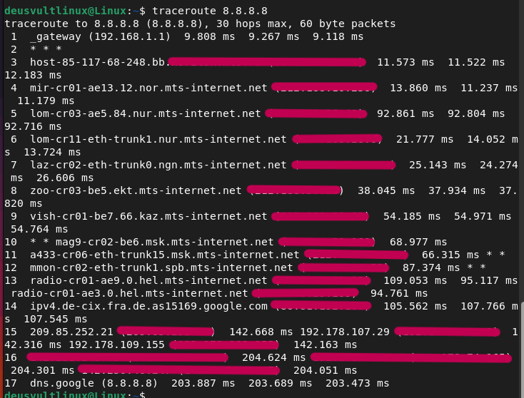

*Рис. 4.1 — Результат команды `traceroute 8.8.8.8`*

### 4.2. netstat

```bash
sudo netstat -tulnp
netstat -rn
```

Первая команда показывает слушающие TCP/UDP-порты и использующие их процессы: `sshd` (порт 22), `apache2` (порт 80), `cupsd` (порт 631), `avahi-daemon`. Вторая показывает таблицу маршрутизации: маршрут по умолчанию через `192.168.1.1` и сеть `192.168.1.0/24` на интерфейсе `enp0s8`.

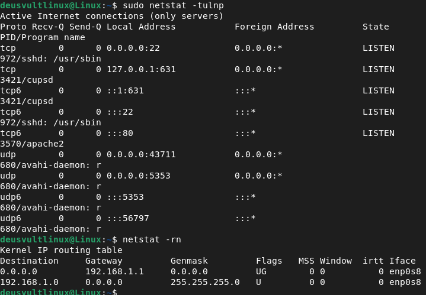

*Рис. 4.2 — Результаты команд `netstat -tulnp` и `netstat -rn`*

### 4.3. ss

```bash
sudo ss -tulnp
sudo ss -t -a
```

Команды показывают те же открытые порты, что и `netstat`: SSH (22, процесс `sshd`), Apache/HTTP (80, процесс `apache2`) и CUPS/IPP (631, процесс `cupsd`), а также UDP-порты службы `avahi-daemon`. Для вывода имён процессов команда запускается с `sudo`.

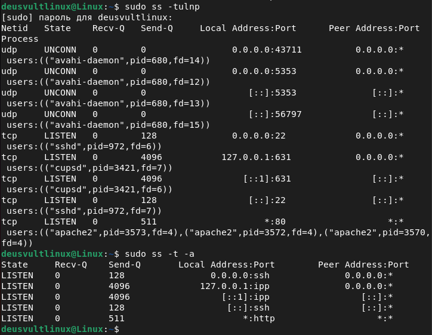

*Рис. 4.3 — Результаты команд `sudo ss -tulnp` и `sudo ss -t -a`*

---

## Вывод

В ходе лабораторной работы изучена работа с пакетным менеджером `apt`: проверен файл `/etc/apt/sources.list` (оставлен без изменений, так как исходная конфигурация уже содержит все необходимые репозитории Debian), установлены пакеты `vim`, `curl`, `net-tools`, `apache2`, написан bash-скрипт для их установки. Настроен автозапуск служб Apache и SSH при помощи `systemctl` и ежедневный перезапуск Apache через `cron`. Для виртуальной машины настроен статический IP-адрес `192.168.1.150/24` (через NetworkManager, так как файл `/etc/network/interfaces` не содержит описания основного интерфейса), сетевая конфигурация проверена командами `ip`, `ifconfig` и `ping`. Для диагностики сети использованы команды `traceroute`, `netstat` и `ss`.
